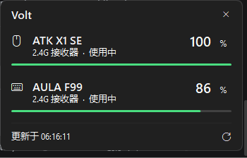

# Volt

<sub>[English](README.md) · [简体中文](README.zh-CN.md)</sub>

[](https://github.com/435311382/Volt/actions/workflows/build.yml)
[](LICENSE)
[](#known-limitations)
[](#how-it-was-built)

**Wireless peripheral battery monitor for Windows.** A tray icon that shows the live battery level of your 2.4G mice, keyboards and headsets — click it and a small flyout lists every device with its percentage and charging state.

Most wireless peripherals never report battery level to Windows. They speak a vendor-private HID protocol that only the manufacturer's software understands, so the OS shows nothing and generic battery widgets see nothing. Volt talks those protocols directly.

> **This project is developed entirely by an AI agent.** Every line of C#, the documentation and the CI configuration were written by AI; a human owner set the scope and tested the result on real hardware. [How it was built](#how-it-was-built) explains the split, because it is the part that affects how you should read the code.



## Contents

- [Why](#why)
- [Features](#features)
- [Install](#install)
- [Supported devices](#supported-devices)
- [How it works](#how-it-works)
- [How it was built](#how-it-was-built)
- [Build](#build)
- [Test](#test)
- [Project layout](#project-layout)
- [Known limitations](#known-limitations)
- [Contributing](#contributing)
- [License](#license)

## Why

I bought an ATK X1 SE mouse and an AULA F99 keyboard. Both are 2.4G wireless, both report nothing to Windows, and neither vendor ships software that puts the level anywhere useful. Existing tools either support a fixed list of models, or misidentify the hardware, or show one device twice when it is connected over both dongle and cable.

Volt is the tool I wanted: two devices, correct names, one row each, live percentages in the tray.

## Features

- **Tray icon with live level** — colour-coded battery (green above 35%, amber 16–35%, red at 15% or below), refreshed every 5 seconds while the flyout is open and every 45 seconds while it is closed.
- **Click to open a flyout** — one row per device: name, connection type, charging state, percentage, level bar.
- **One device, one row** — a mouse connected over both its 2.4G dongle and a USB cable still appears once. Volt picks the active connection, preferring the one that is actually charging.
- **Survives device sleep** — many 2.4G devices stop answering when idle. Volt keeps the last successful reading on disk and shows it as `last 17:52` instead of blanking out.
- **A level that doesn't jump around** — these devices estimate charge from voltage, so the reading climbs whenever the load drops (unplugging the cable, going idle). Volt treats the level as decrease-only, the way Microsoft's battery guidance requires, so a keyboard that reads 96% unplugged stays at 96% instead of bouncing to 84% and back. See [Reading the percentage](docs/PROTOCOLS.md#reading-the-percentage).
- **137 models across 28 vendors** — mice, keyboards, headsets, controllers and the receivers themselves, over 2.4G, Bluetooth and cable. See [Supported devices](#supported-devices).
- **Left, right and case** — a true-wireless headset is three separate batteries. Where the dongle exposes them (Sony INZONE Buds is the one that does), Volt shows all three instead of collapsing them to the lowest.
- **Manual autostart** — Volt writes nothing to the registry and has no autostart switch. To start it at login, add a shortcut to `shell:startup`, or a `REG_SZ` value under `HKCU\Software\Microsoft\Windows\CurrentVersion\Run` pointing at the exe.
- **Single instance** — re-launching the executable reopens the flyout instead of starting a second copy.

## Install

Download `Volt.exe` from [Releases](../../releases) and run it. That's it.

The tray icon appears in the taskbar. If Windows hides it, open the overflow chevron (`^`) and drag the battery icon onto the taskbar.

To start with Windows, add a shortcut to the startup folder, or add a `REG_SZ` value under `HKCU\Software\Microsoft\Windows\CurrentVersion\Run` pointing at the exe.

> **Do not run it from a folder marked Low integrity level.** Windows blocks tray icon registration (`Shell_NotifyIcon` returns `ERROR_ACCESS_DENIED`) for low-integrity processes. `%LOCALAPPDATA%`, `%APPDATA%`, Desktop and Program Files are all fine.

## Supported devices

**137 models, 28 vendors, 217 wireless PIDs and 58 wired PIDs.** Full table: [docs/DEVICES.md](docs/DEVICES.md).

| Vendor | Models | Notable families |
|---|---|---|
| Razer | 46 | Viper, DeathAdder, Basilisk, Naga, Cobra, BlackWidow, BlackShark |
| Logitech | 16 | Lightspeed, Bolt, Unifying, Nano receivers, G PRO, Zone |
| SteelSeries | 12 | Arctis 1/7/9, Nova 3/5/7/7P, Nova Pro, GameBuds |
| HyperX | 10 | Cloud II, Cloud III, Cloud Flight, Cloud Alpha |
| Sony | 6 | INZONE Buds / H5 / H9 II, PULSE 3D, DualSense, DualShock 4 |
| VXE | 5 | MAD R, MAD R Major Plus, R1 Pro Max, R1 SE+ |
| Corsair | 4 | Virtuoso XT / SE, Void, Void V2 |
| MCHOSE | 4 | L7 Pro, K7 Ultra, X9, V9 Pro |
| ATK | 4 | X1 SE, F1 Ultimate, A9 Ultimate, Zero |
| AULA | 4 | F68, F75, F87, F99 (and the LEOBOG keyboards sharing the same dongle) |
| Others | 26 | Jabra, Lamzu, Audeze, Dareu, VGN, ASUS ROG, Lenovo, Plantronics, Ninjutso, Attack Shark, Bloody, Flydigi, G-Wolves, Scyrox, Zaopin, Baseus, NINX, ASTRO |

The table is keyed on VID:PID. A model that exposes the same device over both a dongle and a cable is one row in the flyout, not two: Volt picks the active transport, preferring the one that is actually charging.

Devices fall into two broad groups:

- **Vendor-private protocols** — a report on a vendor usage page (`0xFF02`, `0xFF05`, `0xFF42`, `0xFF90`, `0xFF00` and others). Each family needs its own frame format, checksum and byte offsets. The Compx 17-byte frame alone covers ATK, VXE, VGN, Dareu and G-Wolves.
- **Standard HID battery** — usage page `0x0006` / usage `0x0020`. Any device that implements it works without being listed at all.

Adding a model is usually one line in `src/DeviceTable.cs`; adding a protocol family is one class in `src/ProtocolsVendor.cs`. See [Adding a device](docs/ADDING-A-DEVICE.md).

## How it works

Volt enumerates HID collections through SetupAPI, groups them by VID:PID, matches each group against the model table, then hands the group to the first protocol that claims it. That protocol sends a vendor-private report over overlapped I/O (or a feature report, or just waits for the dongle to push one). The reply carries the battery percentage, a charging flag, and often a pack voltage.

Nothing is injected into Explorer, no driver is installed, and no vendor software is required.

Full protocol notes: [docs/PROTOCOLS.md](docs/PROTOCOLS.md).

## How it was built

Volt is AI-developed. The entire source tree, this README and its Chinese counterpart, the protocol notes, the build script, the CI workflow and the commit messages were produced by an AI coding agent, and the repository is kept the same way. That is stated up front rather than buried, because it changes what you can reasonably expect from the code.

**Written by AI:** all of `src/`, the documentation in `docs/`, `build.bat`, `.github/workflows/build.yml`, and the release notes.

**Decided by a human:** the scope — two devices, no vendor software, no installer, no driver, no elevation. Which features to refuse: lighting control, DPI and macro editing are out of scope by decision, not by oversight. And the hardware verification: plugging the devices in, reading the vendor utility, and comparing its numbers against Volt's.

**What that means for a reader:** the code is small enough to read in an afternoon. The one part that has automated tests is the battery filter — `test/FilterTests.cs`, 38 cases, no framework needed. Everything else is verified by one person with two devices on one machine. Exotic hardware is more likely to hit a reply the parser has never seen than to expose a mistake the documentation is hiding. Anything not written down in [docs/PROTOCOLS.md](docs/PROTOCOLS.md) was never confirmed against real hardware — treat it as unverified rather than as fact.

## Build

Requires only the C# compiler that ships with .NET Framework 4.x — no SDK, no MSBuild, no NuGet.

```bat
build.bat
```

Or by hand:

```bat
C:\Windows\Microsoft.NET\Framework64\v4.0.30319\csc.exe ^
  /target:winexe /platform:anycpu /optimize+ ^
  /win32icon:app.ico /out:Volt.exe ^
  /r:System.dll /r:System.Drawing.dll /r:System.Windows.Forms.dll ^
  src\*.cs
```

The source is C# 5 — no interpolation, no `?.`, no `nameof` — so it compiles with the in-box compiler on a clean Windows install.

## Test

```bat
test.bat
```

Compiles `test/FilterTests.cs` together with `src/Filter.cs` and runs it. The test program is a plain console exe with its own `Main`; it prints each case and exits non-zero on the first failure. No framework, no NuGet.

The 38 cases cover the decrease-only rule: ordinary discharge, a level that rebounds after the cable is pulled, a large jump that is genuinely a charge, out-of-range bytes, a drop that must persist before it is believed, and the resync path for a device that was away for minutes. CI runs this before the release build.

## Project layout

| Path | Purpose |
|---|---|
| `src/HidNative.cs` | SetupAPI enumeration, `hid.dll` caps, overlapped read/write/feature wrapper |
| `src/Protocols.cs` | Shared plumbing: `BatteryReading`, `HidGroup`, `BatteryProtocol`, `HidQuery` |
| `src/ProtocolsVendor.cs` | 23 vendor protocols plus a standard-HID fallback, one class each |
| `src/DeviceTable.cs` | 137-model table, vendor names, user name overrides |
| `src/Filter.cs` | Decrease-only battery filter |
| `src/Scanner.cs` | Group interfaces by VID:PID, pick one connection, persist last readings |
| `src/Theme.cs` | Colours, fonts, rounded-rect helpers |
| `src/TrayIcon.cs` | Runtime icon rendering (multi-size PNG-in-ICO) |
| `src/MainForm.cs` | Flyout window, device rows, tray wiring |
| `src/Program.cs` | Entry point, single-instance mutex |
| `test/FilterTests.cs` | Filter behaviour tests, no framework |
| `tools/` | `docs/DEVICES.md` generator, run after changing the model table |
| `docs/` | Protocol notes, device list, device-adding walkthrough |
| `.github/workflows/build.yml` | CI: runs the tests, then compiles on `windows-latest` |

## Known limitations

- Windows only. The HID layer is Win32.
- **2.4G audio dongles generally do not report battery.** Most headsets expose charge only over Bluetooth (BLE GATT or vendor broadcasts), not over the USB dongle. Volt lists them and says so rather than showing a fake number. The Baseus AeQur G10 is one: its report IDs `0x55` / `0x41` are firmware-upgrade triggers, not telemetry — writing to them can switch the dongle into bootloader mode.
- Polling resets the device idle timer, which costs a little battery. The closed-flyout interval is 45 seconds for that reason; raise it in `MainForm` if it still matters.
- Two battery tools running at once will fight over the same HID handle. Close the vendor software.
- Protocols were ported from open-source projects and documentation, not verified against every listed model. Volt only claims to read the families it ships code for; individual models in the table are best-effort. Unverified models are marked in [docs/DEVICES.md](docs/DEVICES.md).

## Contributing

A new device report is the most useful contribution. See [CONTRIBUTING.md](CONTRIBUTING.md) for what to send, or open a [device report](../../issues/new?template=device-report.md) directly.

## License

MIT — see [LICENSE](LICENSE).
