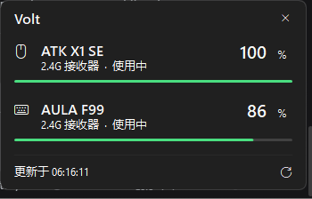

# Volt

<sub>[English](README.md) · 简体中文</sub>

[](https://github.com/435311382/Volt/actions/workflows/build.yml)
[](LICENSE)
[](#已知限制)
[](#这个项目是怎么来的)

**Windows 无线外设电量监控。** 一个任务栏图标，实时显示你的 2.4G 鼠标、键盘和耳机的电量；点一下弹出小面板，逐台列出设备、电量和充电状态。

绝大多数无线外设从不向 Windows 上报电量。它们使用的是一套厂商私有的 HID 协议，只有厂商自家软件能读懂，所以系统里看不到，通用的电量小工具也读不到。Volt 直接跟这套协议对话。

> **本项目全部由 AI 开发。** 每一行 C#、文档和 CI 配置都由 AI 编写；人负责定范围，并在真实硬件上验收。分工细节见[这个项目是怎么来的](#这个项目是怎么来的) —— 它直接影响你该怎样读这份代码。



## 目录

- [为什么做这个](#为什么做这个)
- [功能](#功能)
- [安装](#安装)
- [支持的设备](#支持的设备)
- [工作原理](#工作原理)
- [这个项目是怎么来的](#这个项目是怎么来的)
- [构建](#构建)
- [测试](#测试)
- [项目结构](#项目结构)
- [已知限制](#已知限制)
- [参与贡献](#参与贡献)
- [许可](#许可)

## 为什么做这个

我买了 ATK X1 SE 鼠标和 AULA F99 键盘。两台都是 2.4G 无线，都不向 Windows 上报任何电量，两家的软件也都没把电量放到有用的地方。现成的工具要么只支持一份固定机型列表，要么认错硬件，要么在设备同时插着接收器和线时把它显示成两台。

Volt 就是我想要的那个工具：两台设备，名字正确，各占一行，电量实时显示在任务栏。

## 功能

- **任务栏图标实时电量** —— 按电量变色（高于 35% 为绿色，16%–35% 为琥珀色，15% 及以下为红色），面板打开时每 5 秒刷新，收起时每 45 秒刷新。
- **点击打开弹出面板** —— 每台设备一行：名称、连接方式、充电状态、电量百分比、电量条。
- **一台设备一行** —— 鼠标同时接着 2.4G 接收器和 USB 线时也只显示一次。Volt 会挑实际在用的那条连接，并优先选正在充电的那条。
- **扛得住设备休眠** —— 很多 2.4G 设备闲置后就不再应答。Volt 会把最后一次成功读数存到本地，界面显示成 `上次 17:52`，而不是直接变空。
- **电量不会乱跳** —— 这类设备靠电压估算电量，负载一降读数就往上爬（拔掉线、闲置下来都会）。Volt 按微软电量规范的要求把电量当成只降不升的属性，所以键盘拔线后读到 96% 就一直停在 96%，不会跳到 84% 再跳回来。原理见 [电量怎么读](docs/PROTOCOLS.zh-CN.md#电量怎么读)。
- **137 个型号、28 个厂商** —— 鼠标、键盘、耳机、手柄和接收器本身，覆盖 2.4G、蓝牙和有线。详见[支持的设备](#支持的设备)。
- **左耳、右耳、充电盒分开显示** —— 真无线耳机是三块独立的电池。接收器把三路都吐出来的设备（目前是 Sony INZONE Buds），Volt 会把三路都显示出来，而不是压成最低的那一个。
- **手动配置开机启动** —— Volt 不写注册表，也没有「开机自启」开关。要随系统启动，请往 `shell:startup` 放一个快捷方式，或在 `HKCU\Software\Microsoft\Windows\CurrentVersion\Run` 下加一个指向该 exe 的 `REG_SZ` 值。
- **单实例** —— 重复双击 exe 只会把弹出面板调出来，不会启动第二个副本。
- **零依赖** —— 单个自包含可执行文件，91,136 字节（89 KB）。不需要安装 .NET 运行时，不用 Electron，没有安装程序，也不需要管理员权限。

## 安装

从 [Releases](../../releases) 下载 `Volt.exe`，直接运行即可。

任务栏会出现图标。如果 Windows 把它藏起来了，点开溢出区箭头（`^`），把电池图标拖到任务栏上。

要随 Windows 启动，可以往启动文件夹放一个快捷方式，或在 `HKCU\Software\Microsoft\Windows\CurrentVersion\Run` 下添加一个指向该 exe 的 `REG_SZ` 值。

> **不要从「低完整性级别」标记的目录里运行。** Windows 会拒绝低完整性进程注册托盘图标（`Shell_NotifyIcon` 返回 `ERROR_ACCESS_DENIED`）。`%LOCALAPPDATA%`、`%APPDATA%`、桌面和 Program Files 都没有问题。

## 支持的设备

**137 个型号、28 个厂商、217 个无线 PID、58 个有线 PID。** 完整表格见 [docs/DEVICES.md](docs/DEVICES.md)。

| 厂商 | 型号数 | 主要系列 |
|---|---|---|
| Razer | 46 | Viper、DeathAdder、Basilisk、Naga、Cobra、BlackWidow、BlackShark |
| Logitech | 16 | Lightspeed、Bolt、Unifying、Nano 接收器、G PRO、Zone |
| SteelSeries | 12 | Arctis 1/7/9、Nova 3/5/7/7P、Nova Pro、GameBuds |
| HyperX | 9 | Cloud II、Cloud III、Cloud Flight、Cloud Alpha |
| Sony | 6 | INZONE Buds / H5 / H9 II、PULSE 3D、DualSense、DualShock 4 |
| VXE | 5 | MAD R、MAD R Major Plus、R1 Pro Max、R1 SE+ |
| Corsair | 4 | Virtuoso XT / SE、Void、Void V2 |
| MCHOSE | 4 | L7 Pro、K7 Ultra、X9、V9 Pro |
| ATK | 4 | X1 SE、F1 Ultimate、A9 Ultimate、Zero |
| AULA | 4 | F68、F75、F87、F99（以及共用同一接收器的 LEOBOG 键盘） |
| 其它 | 26 | Jabra、Lamzu、Audeze、达尔优、VGN、ASUS ROG、Lenovo、Plantronics、Ninjutso、Attack Shark、Bloody、飞智、G-Wolves、Scyrox、Zaopin、Baseus、NINX、ASTRO |

设备表以 VID:PID 为键。同一台设备同时有接收器和有线两种连接时，在弹出面板里只占一行 —— Volt 会挑实际在用的那条，并优先选正在充电的那条。

设备大致分两类：

- **厂商私有协议** —— 报文发在厂商用途页上（`0xFF02`、`0xFF05`、`0xFF42`、`0xFF90`、`0xFF00` 等）。每个协议族都要单独处理帧格式、校验和字段偏移。光 17 字节的 Compx 帧就覆盖了 ATK、VXE、VGN、达尔优和 G-Wolves。
- **标准 HID 电量** —— 用途页 `0x0006` / usage `0x0020`。实现了它的设备不用登记就能直接用。

新增型号通常只需在 `src/DeviceTable.cs` 加一行；新增协议族则是在 `src/ProtocolsVendor.cs` 加一个类。详见[添加设备](docs/ADDING-A-DEVICE.zh-CN.md)。

## 工作原理

Volt 通过 SetupAPI 枚举 HID 集合，按 VID:PID 分组，拿每一组去查型号表，然后交给第一个认领它的协议。那个协议会用重叠 I/O 发一条厂商私有报文（也可能是 Feature 报文，或者干脆等接收器主动推送）。回包里带着电量百分比、充电标志，通常还有一个电池组电压。

不往 Explorer 里注入任何东西，不安装驱动，也不需要厂商软件。

完整协议说明见 [docs/PROTOCOLS.zh-CN.md](docs/PROTOCOLS.zh-CN.md)。

## 这个项目是怎么来的

Volt 由 AI 开发。整个源码树、这份 README 及英文版、协议说明、构建脚本、CI 工作流和提交信息，都出自一个 AI 编程助手；仓库的后续维护也走同样的方式。这一点放在显眼处而不是藏起来，因为它决定了你对这份代码能抱多大期待。

**AI 写的：** `src/` 下全部源码、`docs/` 下的文档、`build.bat`、`.github/workflows/build.yml`，以及发布说明。

**人定的：** 范围 —— 不要厂商软件、不要安装程序、不要驱动、不提权；以及明确砍掉的功能：灯效控制、DPI 与宏编辑是决定不做，不是忘了做。还有硬件验证：插上设备、读厂商软件的数值、拿它和 Volt 的数字逐个比对。

**这对读者意味着什么：** 代码量小到一个下午就能读完。有自动化测试的只有电量过滤器这一块 —— `test/FilterTests.cs`，38 个用例，不需要任何框架。其余部分由一个人、两台设备、一台机器验证。冷门硬件更可能撞上解析器没见过的回包，而不是撞上文档刻意掩盖的错误。凡是没有写进 [docs/PROTOCOLS.zh-CN.md](docs/PROTOCOLS.zh-CN.md) 的东西，都没有在真实硬件上确认过 —— 请当成未验证，而不是当成事实。

设备表里有 137 个型号，但真机验证过的只有 ATK X1 SE 和 AULA F99 两个。其余是从开源项目移植的协议，代码路径完整，具体型号没插过。

## 构建

只需要 .NET Framework 4.x 自带的 C# 编译器 —— 不需要 SDK、MSBuild 或 NuGet。

```bat
build.bat
```

或者手动执行：

```bat
C:\Windows\Microsoft.NET\Framework64\v4.0.30319\csc.exe ^
  /target:winexe /platform:anycpu /optimize+ ^
  /win32icon:app.ico /out:Volt.exe ^
  /r:System.dll /r:System.Drawing.dll /r:System.Windows.Forms.dll ^
  src\*.cs
```

源码是 C# 5 —— 没有字符串内插、没有 `?.`、没有 `nameof` —— 因此在干净安装的 Windows 上用系统自带编译器就能编。

## 测试

```bat
test.bat
```

把 `test/FilterTests.cs` 和 `src/Filter.cs` 一起编译并运行。测试程序就是个自带 `Main` 的普通控制台 exe，逐条打印结果，失败时返回非零。不用框架，不用 NuGet。

38 个用例覆盖只降不升这条规则：正常放电、拔线后的电量回弹、确实充过电的大幅上涨、超范围字节、必须持续一段时间才采信的下跌，以及设备离开几分钟之后的重新同步。CI 会在出构建产物之前先跑它。

## 项目结构

| 路径 | 作用 |
|---|---|
| `src/HidNative.cs` | SetupAPI 枚举、`hid.dll` 能力查询、重叠读写与 Feature 报文封装 |
| `src/Protocols.cs` | 公共基础设施：`BatteryReading`、`HidGroup`、`BatteryProtocol`、`HidQuery` |
| `src/ProtocolsVendor.cs` | 23 套厂商协议，外加一个标准 HID 电池兜底，每个一个类 |
| `src/DeviceTable.cs` | 137 条型号表、厂商名、用户自定义改名 |
| `src/Filter.cs` | 只降不升的电量过滤器 |
| `src/Scanner.cs` | 按 VID:PID 分组、选一条连接、持久化上次读数 |
| `src/Theme.cs` | 配色、字体、圆角矩形辅助 |
| `src/TrayIcon.cs` | 运行时生成图标（多尺寸 PNG-in-ICO） |
| `src/MainForm.cs` | 弹出面板窗口、设备行、托盘联动 |
| `src/Program.cs` | 入口、单实例互斥体 |
| `test/FilterTests.cs` | 过滤器行为测试，不用框架 |
| `tools/` | `docs/DEVICES.md` 生成器，改完型号表跑一次 |
| `docs/` | 协议说明、设备清单、添加设备指南 |
| `.github/workflows/build.yml` | CI：先跑测试，再在 `windows-latest` 上编译 |

## 已知限制

- 仅支持 Windows。HID 这一层是 Win32。
- **2.4G 音频接收器普遍不上报电量。** 大多数耳机只在蓝牙（BLE GATT 或厂商广播）上暴露电量，USB 接收器这一侧没有。型号表里标注为这种情况的设备不会显示在浮窗里，免得一直占一行空白；万一哪天真读到了，它会自己出现。Baseus AeQur G10 就是其中之一：它的报告 ID `0x55` / `0x41` 是固件升级触发器而不是电量通道，往里写有可能把接收器切进引导模式。
- 轮询会重置设备空闲计时器，会多耗一点电。面板收起时的间隔定为 45 秒就是这个原因；如果还是介意，可以调大 `MainForm` 里的间隔。
- 两个电量工具同时运行会抢同一个 HID 句柄。用之前先关掉厂商软件。
- 协议是从开源项目和文档移植的，没有对表里每个型号逐一实测。Volt 只声称能读它确实写了代码的那些协议族；表里单个型号属于尽力而为。[docs/DEVICES.md](docs/DEVICES.md) 里标注了哪些是实测过的。

## 参与贡献

最有价值的贡献是新的设备上报。要提供什么信息见 [CONTRIBUTING.zh-CN.md](CONTRIBUTING.zh-CN.md)，也可以直接开一个[设备上报 issue](../../issues/new?template=device-report.md)。

## 许可

MIT —— 见 [LICENSE](LICENSE)。
